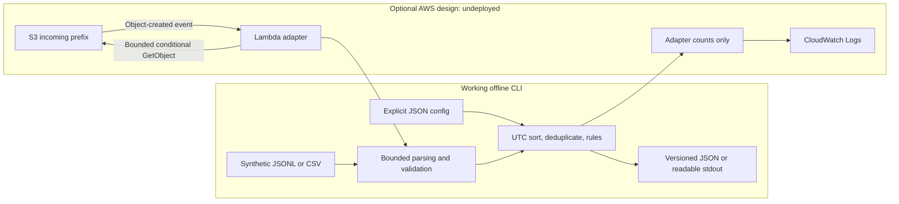

# Log anomaly detector

A working Python CLI for offline authentication-log analysis. It detects failed
login bursts, password sprays across users and successful logins from sources
outside an explicit baseline. Every finding explains its rule and evidence count.
This is rule-based detection, with no ML or external services required.

An original portfolio project for **notfrostedwow**. All included users and logs
are made up; addresses use documentation-only IP ranges. The optional AWS adapter
is undeployed and tested only with offline fakes. There is no hosted demo,
certification claim or verified remote CI run.

## Try the CLI

Python 3.11+ is required. From this repository in PowerShell:

```powershell
python -m venv .venv
.venv/Scripts/python -m pip install -e .
.venv/Scripts/log-anomaly-detector samples/auth.jsonl --format jsonl --config samples/config.json
```

That analysis exits **1**, meaning it found alerts. This is expected. The actual
captured run begins:

```text
Authentication analysis | schema 1.0 | offline rules
Events: 13 | unique: 12 | duplicates removed: 1
Findings: 3
```

The findings are five failures for `mira` from `192.0.2.44`, failures for five
distinct users from `198.51.100.20`, and a success for `mira` from `203.0.113.9`
outside her baseline. Read the complete generated [text report](samples/report.txt),
[JSON report](samples/report.json), and [actual CLI transcript](docs/validation/cli-demo.txt).

```powershell
.venv/Scripts/log-anomaly-detector samples/auth.jsonl --format jsonl --config samples/config.json --json
.venv/Scripts/log-anomaly-detector samples/auth.csv --format csv --config samples/config.json --json
.venv/Scripts/log-anomaly-detector samples/quiet.jsonl --format jsonl
.venv/Scripts/python -m log_anomaly_detector.cli --help
```

JSONL and CSV samples produce byte-identical JSON reports. The quiet sample exits
0. The program writes only stdout/stderr. Shell redirection can save a report;
Windows PowerShell 5 may encode redirects as UTF-16, so use the Python capture
script below to preserve the report's UTF-8 bytes.

On Linux/macOS, use `.venv/bin/python` and `.venv/bin/log-anomaly-detector` for the
same commands. Only Windows/Python 3.11.9 was run locally. The Linux CI matrix is
configured for Python 3.11/3.12 and has not run remotely.

| Exit | Meaning |
| --- | --- |
| 0 | Complete analysis with no findings, or successful help/version request |
| 1 | Complete analysis with one or more findings |
| 2 | Argument, config, validation or local I/O error; analysis unsuccessful |

## Input and rules

Each record has exactly `timestamp`, `user`, `source_ip`, `outcome`:

```json
{"timestamp":"2026-01-01T00:00:00Z","user":"mira","source_ip":"192.0.2.44","outcome":"failure"}
```

Timestamps require `Z` or a numeric timezone offset. Naive dates are rejected.
CSV has one physical row per record and an exact four-field header in any order.
[docs/schema.md](docs/schema.md) specifies field restrictions, inclusive windows,
equal-time batching, deduplication and the versioned report contract. Empty JSONL
and header-only CSV are valid empty datasets.

By default a window is **[t − 300 seconds, t]**, including both boundaries:

| Rule | Trigger |
| --- | --- |
| `failed_login_burst` | At least 5 failures for one user from one source IP |
| `password_spray` | Failures for at least 5 distinct users from one source IP |
| `unusual_source` | First success per user/source outside that user's explicit allowed IPs |

Failure rules emit once per qualifying group and distinct failure timestamp.
Overlapping windows can produce several findings for one incident. Unusual-source
checks run only for baseline-listed users; other users are unassessed by that
rule. No baseline disables that rule. Current input never establishes trust.

Use [samples/config.json](samples/config.json) as a starting point. Unknown keys
and invalid types fail validation; there is no environment-based CLI config.

| Setting | Default | Accepted range / shape |
| --- | --- | --- |
| `window_seconds` | 300 | Integer 1–86,400 |
| `burst_threshold`, `spray_threshold` | 5 each | Integer 2–1,000 |
| `max_file_bytes` | 8,388,608 | Integer 1–8,388,608 |
| `max_line_bytes` | 16,384 | Integer 1–16,384, including line endings |
| `max_events` | 20,000 | Integer 1–20,000 before deduplication |
| `max_findings` | 2,000 | Integer 1–2,000; exceeding it rejects analysis |
| `baseline` | `{}` | Up to 1,000 users, each with 1–32 exact allowed source IPs |

Config files are capped at 64 KiB; booleans are rejected for integer settings.
Caps can be lowered but not raised beyond these ceilings. The tool rejects
special files, symlinks/reparse paths and Windows network/device/alternate-stream
paths. It reads no URLs or archives. See [SECURITY.md](SECURITY.md).

## Architecture



The CLI uses only the standard library. The AWS entry point imports boto3 lazily;
ordinary CLI imports never create cloud clients. Adapter fetch/output functions
are injected for offline tests. [docs/cloud.md](docs/cloud.md) covers service
choices, IAM scopes, retries, idempotency limits, intended deployment steps
**not executed**, and dated illustrative costs. No credentials or Docker are
needed for local checks.

## Run the checks

```powershell
.venv/Scripts/python -m pip install -e . -r requirements-dev.txt
.venv/Scripts/python tools/verify.py
.venv/Scripts/python tools/capture_demo.py
```

`verify.py` runs pytest, Ruff lint/format, strict mypy, `pip check` and
network-disabled cfn-lint. Actual local commands/results are saved in
[docs/verification.md](docs/verification.md). Tests cover positives, negatives,
boundaries, timezones, CSV/JSONL, malformed data, config, bounds and fake cloud I/O.
GitHub Actions has only `contents: read` and no credentials/deployment steps.
There is no badge because no remote workflow run has been verified.

## Tuning and limits

A burst is suspicious activity, not proof of compromise. Shared NAT can look like
a spray; expired passwords and retrying clients can look like brute force.
Travel, VPNs and changing IPv6 addresses can trigger unusual-source findings.
Tune against authorized historical data and review baselines with the system
owner. Do not automatically trust a newly observed IP.

Rows are sorted in memory within fixed caps. Exact normalized duplicates collapse,
so real attempts with identical fields/timestamp precision will be undercounted.
There are no event IDs, cross-file windows, distributed-source correlation,
geolocation, account lockout integration or alert delivery. Slow attempts,
multiple IPs and a trusted compromised source can evade these rules. Finding
counts measure qualifying windows, not incidents. Smaller files avoid cap errors
but can miss patterns across file boundaries.

The schema uses narrow ASCII user identifiers; real vendor logs need a separately
tested converter. IP comparison is exact and canonical, without CIDR matching or
reputation lookups. Plain IPv4 and IPv4-mapped IPv6 remain distinct.

Read [ZAHEER-GUIDE.md](ZAHEER-GUIDE.md) for the walkthrough and interview discussion,
and [CONTRIBUTING.md](CONTRIBUTING.md) for local contribution checks. Original code
is [MIT licensed](LICENSE), Copyright (c) 2026 Zaheer Miah, with Zaheer's explicit
approval. Dependencies retain [their own licenses/notices](docs/dependencies.md).
Parent review controls publication; no remote repository was created or pushed.
